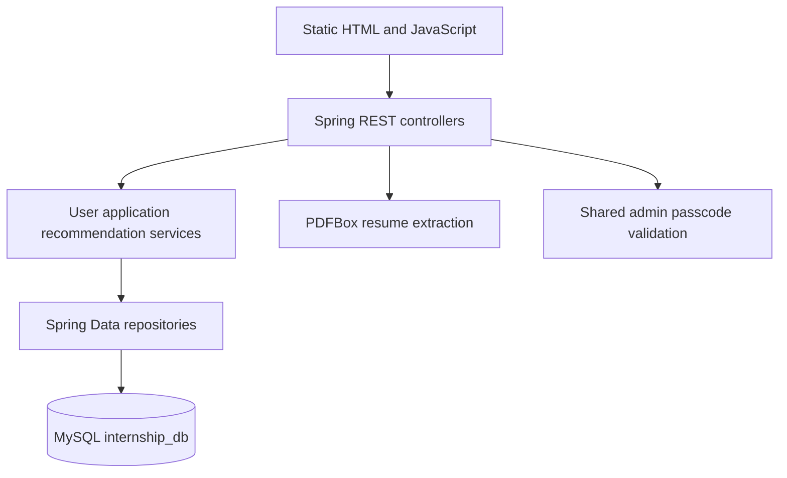
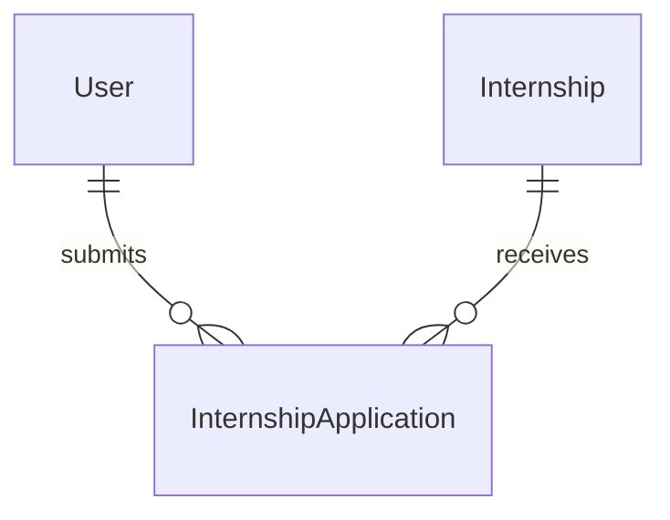

<a id="top"></a>

<div align="center">

# 🎓 InternHub

**A Spring Boot internship portal with transparent skill-overlap recommendations.**


[Repository](https://github.com/ashishgiije/InternHub---Internship-Recommender-) · [Overview](#overview) · [Architecture](#architecture) · [Setup](#setup) · [Validation](#testing-and-validation) · [Audit](AUDIT_REPORT.md)

</div>

## Overview

InternHub lets students register, maintain a profile, explore internships, compare their skills with role requirements, and track applications. Administrative routes manage internships and application status. Recommendations use deterministic string matching, not a trained ML model or LLM.

## Visual preview

**Screenshot placeholder:** No verified application screenshot is supplied here. Capture the study chat, indexed document list, and citation card using disposable notes. No image is fabricated.

## Key features

- Registration/login and profile editing.
- Internship catalog and application tracking.
- Skill-overlap ranking with missing-skill suggestions and an interest bonus.
- Resume text extraction from PDF or UTF-8 input with keyword-based skill discovery.
- Administrative internship CRUD and application status updates.

## Technology stack

| Technology | Role in this checkout |
|---|---|
| Java 17 + Spring Boot 3.3.2 | REST services and static UI hosting |
| Spring Data JPA + MySQL | Users, internships, and applications |
| Jakarta Validation + BCrypt | Request validation and password hashing |
| Apache PDFBox 3 | Resume PDF text extraction |
| HTML + CSS + JavaScript | Static browser interface |

## Architecture



## Application workflow

Register/login → view profile → extract or enter skills/interests → request recommendations → apply to an internship → view applications. Administrator supplies a passcode to manage listings and statuses. User-ID routes currently lack authenticated ownership enforcement; do not treat login as end-to-end session security.

## Setup

```bash
git clone https://github.com/ashishgiije/InternHub---Internship-Recommender-.git
cd InternHub---Internship-Recommender-
```

Use JDK 17+, Maven, and MySQL. There is no Maven wrapper. Create a local database using an account authorized for that local instance:

```sql
CREATE DATABASE internship_db;
```

Override committed credentials through Spring environment configuration: `SPRING_DATASOURCE_URL`, `SPRING_DATASOURCE_USERNAME`, `SPRING_DATASOURCE_PASSWORD`, and `APP_ADMIN_PASSCODE`. Set these privately; do not use committed development values. Hibernate uses `ddl-auto=update`, which can alter the selected database, so use a disposable local database.

```bash
cd backend
mvn spring-boot:run
```

Open `http://localhost:8080`. The backend includes static pages under `src/main/resources/static`; the separate `frontend/` tree contains another copy.

```bash
mvn test
mvn package
```

No existing test source suite was found; a successful Maven test phase with zero tests would not verify application behavior. Production hosting requires MySQL, private configuration, and authentication fixes.

## Project structure

```text
backend/pom.xml                     # Java 17 and Maven dependencies
backend/src/main/java/.../controller # REST endpoints
backend/src/main/java/.../service    # Business logic and ranking
backend/src/main/java/.../entity     # User, Internship, application
backend/src/main/java/.../repository # JPA access
backend/src/main/resources/static/   # UI served by Spring Boot
frontend/                           # Separate static UI copy
```

## Recommendation method

1. Split comma-separated skills/interests, trim, lowercase, and deduplicate.
2. For each internship with required skills, compute `100 × matched required skills / total required skills`.
3. Add up to 10 interest-match points and cap the score at 100.
4. Sort descending and return missing skills and suggested skills.

The score is a matching heuristic, not model accuracy or a probability of hiring. Resume extraction matches a fixed skill vocabulary using substrings; short words can produce false positives. No training dataset or held-out evaluation is supplied.

## Data relationships



## API

| Method | Path | Current access behavior |
|---|---|---|
| POST | `/api/auth/register`, `/api/auth/login` | Public credential exchange |
| GET | `/api/internships` | Public catalog |
| POST | `/api/recommend` | Skills/interests payload |
| GET | `/api/users/{userId}` | Caller-selected user ID; no principal check |
| PUT | `/api/users/{userId}/profile` | Caller-selected user ID; no principal check |
| GET | `/api/users/{userId}/applications` | Caller-selected user ID |
| POST | `/api/users/{userId}/applications/{internshipId}` | Caller-selected user ID |
| POST | `/api/users/{userId}/resume-extract` | Multipart `file` |
| POST | `/api/admin/login` | Shared passcode |
| GET | `/api/admin/applications` | Admin passcode |
| PUT | `/api/admin/applications/{applicationId}/status` | Admin passcode |
| GET / POST | `/api/admin/internships` | Admin passcode |
| PUT / DELETE | `/api/admin/internships/{id}` | Admin passcode |

```bash
curl -X POST http://localhost:8080/api/recommend \
  -H 'Content-Type: application/json' \
  -d '{"skills":"java, sql","interests":"backend"}'
```

The response DTO contains `recommendations` and `suggestedSkills`. Recommendation entries include `matchingScore` and `missingSkills`; actual values depend on the database.

## Testing and validation

Current source review and checks (4 November 2026):

Controllers, services, entities, configuration, static UI, and Maven manifest inspected. Maven/MySQL runtime validation has not been completed. No existing Java test source suite was found.

Use the setup commands above and the documented workflow for a local smoke check. No passing automated application suite is claimed where none exists.

## Limitations and roadmap

- Login does not establish authorization on user-ID routes.
- Admin authorization is a shared passcode rather than an identity/role session.
- No seeded internship dataset or evaluation benchmark is provided.
- Generated `backend/target` output is committed and is not proof of a current successful build.
- Suggested roadmap: authenticated ownership checks, safe DOM rendering, migrations, CI, and integration tests.

<details>
<summary>Troubleshooting and contributions</summary>

Check the runtime versions and working directory first. For dependency installation failures, preserve TLS and checksum verification and inspect the first error. For external services, verify your local configuration and account permissions without sharing secret values.

Before contributing, read [the audit](AUDIT_REPORT.md), reproduce the affected behavior, and keep documentation changes separate from application fixes. Add tests for changed behavior and describe remaining limitations accurately.

</details>

## Author

**Ashish Gije** · [GitHub](https://github.com/ashishgiije)

[Back to top](#top)
